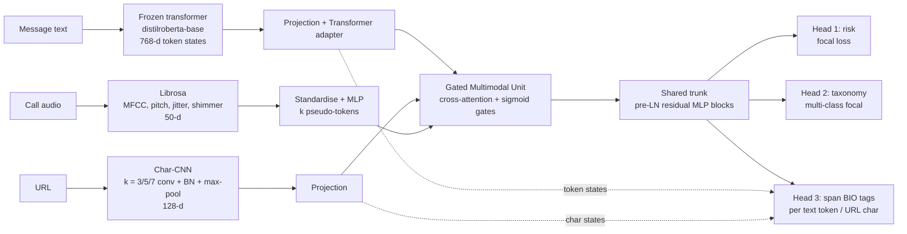

# ScamShield v2: Multi-Task, Multimodal Scam Detection

ScamShield v2 is a PyTorch system that reads a message, the URL inside it and,
optionally, the audio of a phone call. From those it predicts:

1. **Risk**: the probability that the input is a scam (binary, focal loss).
2. **Taxonomy**: the fraud type (Phishing, Credential Harvesting, Tech Support Impersonation, Financial Coercion, Crypto Fraud, or Benign).
3. **Evidence spans**: the words in the message and the characters in the URL that drive the threat (token-level BIO tagging).

Every prediction also reports **epistemic and aleatoric uncertainty** from
Monte Carlo dropout and an **out-of-distribution flag** for unfamiliar scam
patterns. With `explain=true` it adds **Integrated-Gradients attributions**
over tokens, URL segments and acoustic features. A heavy **teacher** model is
compressed into a **student** about 17× smaller by **knowledge distillation**.

> **Status.** The code is complete and passes an offline test suite (17 tests)
> that trains on a *toy synthetic* dataset. It has **not** been trained or
> evaluated on a real labelled scam corpus yet, so this README contains no
> accuracy claims. See [Evaluating on real data](#evaluating-on-real-data).

---

## Architecture



| Component | File | Notes |
|---|---|---|
| Char-CNN URL encoder | `src/models/char_cnn_url.py` | Case-preserving 94-symbol alphabet plus a dedicated non-ASCII token for IDN homoglyphs. Three parallel conv branches (k = 3, 5, 7) with BatchNorm, GELU and a stride-1 max-pool. Masked global max+mean pooling is concatenated with 7 lexical stats (Shannon entropy, digit ratio, sub-domain depth, IP host, …) and projected to 128-d. Per-character features are kept for span tagging. |
| Gated Multimodal Unit | `src/models/gated_fusion.py` | `h_m = tanh(W_m x_m)`. Each modality cross-attends to the other modalities' tokens plus a learned null token. Per-dimension sigmoid gates are `z_m = σ(W_z [π₁h₁; π₂h₂; π₃h₃; π]) · π_m`, and the fused vector is `f = Σ z_m ⊙ h_m`. A missing modality gets a gate of exactly 0. |
| Multi-task network | `src/models/multitask_net.py` | Shared residual trunk feeding three heads. `forward_from_embeddings` exposes continuous inputs for attribution. Acoustic standardisation stats are model buffers, so they ship with the checkpoint. |
| Student | `src/models/student_model.py` | Same interface. Plain GMU with no cross-attention, no text adapter, a 2-branch 64-channel Char-CNN and d = 128. |
| Losses | `src/training/losses.py` | Binary and multi-class focal loss, Kendall et al. learned task weighting, and τ²-scaled KL distillation on all three heads. |
| Distillation loop | `src/training/train_distill.py` | AdamW with warm-up and cosine decay, gradient clipping, modality dropout, early stopping, OOD threshold calibration, and a CLI. |
| Uncertainty / OOD | `src/inference/uncertainty.py` | Vectorised MC dropout (batch tiling; BatchNorm stays in eval mode). Variance and BALD entropy decompositions. Quantile-calibrated OOD threshold. |
| Pipeline | `src/inference/pipeline.py` | Raw text, URL and audio in, JSON verdict out. URLs are auto-extracted from text and never fetched. Optional Whisper transcript. |
| Explainability | `src/explainability/attributions.py` | Captum Integrated Gradients jointly over text hidden states, URL char embeddings and acoustic features, with convergence delta. KernelSHAP cross-check on acoustic features. |
| API | `app.py` | FastAPI: `/health`, `/v1/model`, `/v1/predict`, `/v1/predict/audio`. Returns 503 instead of serving an untrained model. |

### Key equations

**Focal loss** (risk head; the taxonomy and span heads use the multi-class form)

$$\mathrm{FL}(p_t) = -\alpha_t\,(1-p_t)^{\gamma}\,\log p_t,\qquad p_t = \begin{cases}p & y=1\\ 1-p & y=0\end{cases}$$

**Learned task weights** (Kendall, Gal & Cipolla 2018), with $s_k = \log\sigma_k^2$:

$$\mathcal{L}_{\text{hard}} = \sum_k e^{-s_k}\,\mathcal{L}_k + s_k$$

**Distillation** (Hinton et al. 2015), applied to the risk, taxonomy and span heads:

$$\mathcal{L}_{\text{student}} = \alpha\,\tau^2\,\mathrm{KL}\!\left(\mathrm{softmax}(z^T/\tau)\,\|\,\mathrm{softmax}(z^S/\tau)\right) + (1-\alpha)\,\mathcal{L}_{\text{hard}}$$

**Uncertainty** over $N$ MC-dropout samples $p_s$:

$$\underbrace{\bar p(1-\bar p)}_{\text{total}} = \underbrace{\mathbb{E}_s[p_s(1-p_s)]}_{\text{aleatoric}} + \underbrace{\mathrm{Var}_s[p_s]}_{\text{epistemic}}, \qquad \underbrace{\mathbb{I}[y;W]}_{\text{epistemic}} = \mathcal{H}[\bar p] - \mathbb{E}_s\mathcal{H}[p_s]$$

The OOD score is $\mathbb{I}_{\text{taxonomy}} + \mathbb{I}_{\text{risk}}$. An input
is flagged when the score exceeds the 95th percentile of the in-distribution
validation score.

---

## Repository layout

```
scamshield-v2/
├── app.py                         backend: FastAPI service
├── frontend.py                    frontend: Streamlit SOC dashboard (same UI as v1) on the v2 API
├── requirements.txt
├── pyproject.toml                 pytest config
├── src/
│   ├── config.py                  label spaces, feature dims, teacher/student configs
│   ├── models/
│   │   ├── char_cnn_url.py
│   │   ├── gated_fusion.py
│   │   ├── multitask_net.py
│   │   └── student_model.py
│   ├── training/
│   │   ├── losses.py
│   │   └── train_distill.py
│   ├── inference/
│   │   ├── uncertainty.py
│   │   └── pipeline.py
│   ├── explainability/
│   │   └── attributions.py
│   ├── features/                  (supporting) frozen text encoder, Librosa features
│   └── data/                      (supporting) JSONL dataset + collation, toy synthetic generator
└── tests/test_smoke.py
```

---

## Quick start

```bash
pip install -r requirements.txt

# 1. Offline smoke run on toy synthetic data (no downloads; checks the code, not the model)
python -m pytest -q
python -m src.training.train_distill --synthetic 256 --text-encoder hashing --epochs 3 --out artifacts/smoke

# 2. Build a weakly-labelled dataset from public sources (SMS Spam Collection,
#    phishing URL feeds, top-site domains) -> data/train.jsonl, data/val.jsonl, data/dataset_card.json
python scripts/build_dataset.py --augment-templates 300

# 3. Real training (see the data format below)
python -m src.training.train_distill --train data/train.jsonl --val data/val.jsonl \
    --text-encoder distilroberta-base --stage both --epochs 10 --out artifacts/

# 4. Serve the distilled student
SCAMSHIELD_CHECKPOINT=artifacts/student.pt uvicorn app:app --port 8000
#   Windows PowerShell:  $env:SCAMSHIELD_CHECKPOINT="artifacts/student.pt"; uvicorn app:app --port 8000

# 5. Frontend (second terminal), then open http://localhost:8501
streamlit run frontend.py

# or call the API directly
curl -X POST localhost:8000/v1/predict -H "Content-Type: application/json" \
     -d '{"text": "Your account is suspended, verify at http://paypa1-secure.com/login", "explain": true}'
curl -X POST localhost:8000/v1/predict/audio -F file=@call.wav -F text="(optional transcript)"
```

### About `scripts/build_dataset.py`

The public sources only say *scam / not scam*. The script adds the fraud
category and suspicious spans with keyword rules, so those labels are **weak**
(every record is tagged `label_source`). SMS spam is mostly prize and
premium-number spam, so Financial Coercion and Crypto Fraud are nearly absent.
`--augment-templates N` adds N toy template examples to the training split only,
to give those classes some coverage. Hand-label a few hundred real examples
before trusting the taxonomy or span heads.

### Training data format (JSONL, every modality optional)

```json
{"text": "Final notice: pay the overdue tax via gift cards", "url": null,
 "acoustic": null, "audio_path": "calls/0007.wav",
 "is_scam": 1, "category": "Financial Coercion",
 "text_spans": [[0, 12], [14, 34], [39, 49]], "url_spans": []}
```

Spans are character ranges. They are converted to BIO tags through each
tokenizer's offset mapping, so the labels stay valid when the text encoder
changes.

### Response shape (abridged)

```json
{
  "risk_score": 0.93, "verdict": "scam", "needs_review": false,
  "category": "Credential Harvesting",
  "taxonomy": {"Credential Harvesting": 0.71, "Phishing": 0.22, "...": 0.07},
  "uncertainty": {"epistemic_variance": 0.0011, "aleatoric_variance": 0.064,
                  "mutual_information": 0.012, "ood_score": 0.015,
                  "ood_threshold": 0.021, "is_out_of_distribution": false, "mc_samples": 30},
  "modality_gates": {"text": 0.52, "acoustic": 0.0, "url": 0.49},
  "suspicious_spans": {"text": [{"text": "confirm your password", "score": 0.81}],
                       "url": [{"text": "paypa1-secure.com", "score": 0.77}]},
  "explanation": {"method": "integrated_gradients", "convergence_delta": -0.0006,
                  "top_text_tokens": [...], "top_url_segments": [...], "top_acoustic_features": [...]}
}
```

(The values above show the format only. They are not measured results.)

---

## Evaluating on real data

There are no published numbers yet. To produce numbers worth reporting:

1. Assemble a labelled corpus. Public starting points include SMS spam
   collections, PhishTank / OpenPhish URL feeds paired with benign URLs (for
   example Tranco top sites), and reported scam call transcripts. Taxonomy
   labels and evidence spans will need manual annotation.
2. Split by **source and time**, not randomly, so near-duplicate campaigns do
   not leak across splits. Hold out one scam family entirely to test the OOD
   flag.
3. Report risk AUROC / PR-AUC, taxonomy macro-F1, span token-F1, OOD AUROC on
   the held-out family, the teacher vs. student gap, and student latency
   (`measure_latency` in `student_model.py`). `train_distill.py` already
   writes most of these to `training_summary.json`.

The metrics printed by the synthetic smoke run come from templated toy data
and only show that the optimisation works.

---

## Design notes and limitations

* **Frozen text backbone.** The transformer is not fine-tuned, which keeps
  training feasible on a CPU and lets the teacher and student share cached
  features. Unfreezing the top layers is the obvious next step when a GPU and
  real data are available. The student still depends on a 768-d backbone at
  inference; pairing it with a smaller encoder (e.g. MiniLM) would need a
  projection layer and re-caching.
* **Jitter and shimmer are approximated** from frame-level pYIN F0 and RMS,
  not from the cycle-to-cycle periods that Praat computes.
* **MC dropout is an approximation** to Bayesian inference. The OOD threshold
  is a quantile on validation data, so its false-alarm rate holds only for
  traffic that resembles that data.
* **URLs are analysed lexically and never fetched.**
* The v1 app (`main.py` + Streamlit `app.py` in the parent folder) is left
  untouched. v2 is a separate package.

---

## Resume bullets

These describe what was built. Add numbers only after you have evaluated on
real data (the `[…]` slots).

* Designed and implemented a **multi-task, multimodal PyTorch network** that fuses transformer text embeddings, a **custom character-level CNN URL encoder** and Librosa acoustic features (MFCC, pitch, jitter, shimmer) through a **Gated Multimodal Unit with cross-modal attention**. Learned sigmoid gates suppress noisy or missing modalities.
* Trained **three jointly optimised heads** (scam risk, a 6-way fraud taxonomy, and token/character-level evidence-span extraction) with **focal loss** for class imbalance and **homoscedastic-uncertainty task weighting**.
* Built **Monte Carlo dropout inference** that separates **epistemic from aleatoric uncertainty** (variance and BALD mutual-information decompositions) and flags out-of-distribution, zero-day scam patterns against a validation-calibrated threshold. *[OOD AUROC on a held-out scam family: …]*
* Compressed the teacher into a **student about 17× smaller** (10.7M → 0.6M parameters) via **knowledge distillation** using temperature-scaled KL divergence on all three heads plus hard focal loss. *[student vs. teacher AUROC gap: …; CPU latency: … ms]*
* Added **Captum Integrated Gradients** attributions across text tokens, URL sub-domain segments and acoustic features, with completeness checks, and served everything through a **FastAPI** service that returns verdicts, uncertainty, gates and explanations.
* Wrote an offline **pytest suite** that verifies the mathematical identities (focal → BCE at γ = 0, KL = 0 for identical logits, variance decomposition, IG completeness), missing-modality gating, and the end-to-end train → distil → serve path.
